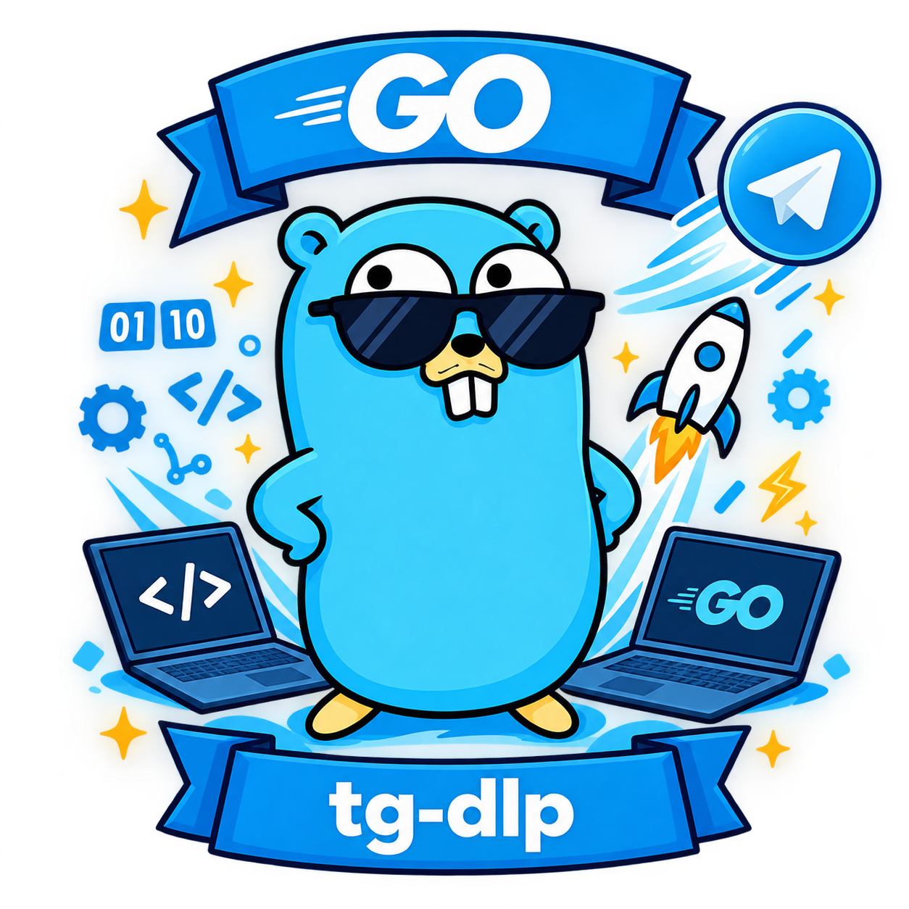

<div id="top"></div>

# tg-dlp



**မြန်ဆန်ပြီး လုံခြုံစိတ်ချရသော၊ စနစ်အားလုံးနှင့် အဆင်ပြေသည့် Telegram မီဒီယာ ဒေါင်းလုဒ်ဆွဲ ပရိုဂရမ်။**
<p>
  <code>tg-dlp</code> သည် Telegram မှ မီဒီယာဖိုင်များ၊ ဗီဒီယိုများ၊ ဓာတ်ပုံများနှင့် စာတိုများကို အလွန်လျင်မြန်စွာ ဒေါင်းလုဒ်ဆွဲနိုင်ရန် ဒီဇိုင်းထုတ်ထားသော အစွမ်းထက် Command-Line Interface (CLI) ကိရိယာတစ်ခု ဖြစ်ပါသည်။
</p>
<p>
  Go ဘာသာစကားဖြင့် တည်ဆောက်ထားသည့်အတွက် စွမ်းဆောင်ရည်မြင့်မားပြီး ယုံကြည်စိတ်ချရပါသည်။ သင့် Telegram Session များကို AES-256-GCM နှင့် Argon2id hashing ကဲ့သို့သော စံချိန်မီ လုံခြုံရေးစနစ်များဖြင့် ဒေသတွင်း၌ လုံခြုံစွာ သိမ်းဆည်းပေးထားပါသည်။ Windows, macOS နှင့် Linux စသည့် စနစ်အားလုံးတွင် ချောမွေ့စွာ အသုံးပြုနိုင်ပါသည်။
</p>

[](https://go.dev/)
[](https://opensource.org/licenses/MIT)
[]()
[]()

<br>
<a href="README.md">English</a> | မြန်မာ

</div>

---

## 📑 မာတိကာ

- [✨ အင်္ဂါရပ်များ](#-အင်္ဂါရပ်များ)
- [📸 ကြိုတင်ကြည့်ရှုရန်](#-ကြိုတင်ကြည့်ရှုရန်)
- [📦 တပ်ဆင်ခြင်း](#-တပ်ဆင်ခြင်း)
- [🚀 အမြန်စတင်ခြင်း](#-အမြန်စတင်ခြင်း)
- [📖 Command လမ်းညွှန်](#-command-လမ်းညွှန်)
- [⚙️ အထွေထွေ ရွေးချယ်စရာများ](#️-အထွေထွေ-ရွေးချယ်စရာများ)
- [🔍 Command အလိုက် ရွေးချယ်စရာများ](#-command-အလိုက်-ရွေးချယ်စရာများ)
- [🔐 လုံခြုံရေးနှင့် ကိုယ်ရေးကိုယ်တာ](#-လုံခြုံရေးနှင့်-ကိုယ်ရေးကိုယ်တာ)
- [🛠️ ဖွံ့ဖြိုးတိုးတက်ရေး](#️-ဖွံ့ဖြိုးတိုးတက်ရေး)
- [📄 လိုင်စင်](#-လိုင်စင်)

---

## ✨ အင်္ဂါရပ်များ

- 🔐 **စစ်တပ်အဆင့် လုံခြုံရေး (Military-grade Encryption)**: Session များကို AES-256-GCM နှင့် Argon2id ဖြင့် Local အတွင်းမှာပဲ လုံခြုံစွာ သိမ်းဆည်းထားပါသည်။
- 📥 **အစုလိုက်အပြုံလိုက် ဒေါင်းလုဒ်ဆွဲခြင်း (Bulk Downloading)**: Channel တစ်ခုလုံး၊ Post တစ်ခုတည်း သို့မဟုတ် Forum Thread တစ်ခုကို ဒေါင်းလုဒ်ဆွဲနိုင်ပါသည်။
- 📤 **တင်ခြင်း (Uploading)**: Include/Exclude filter များဖြင့် ဖိုင်များ သို့မဟုတ် Folder တစ်ခုလုံးကို တင်နိုင်ပါသည်။
- 💾 **အရန်သိမ်းဆည်းခြင်းနှင့် ပြန်လည်ရယူခြင်း (Backup & Restore)**: Channel မက်ဆေ့ချ်များကို JSON အဖြစ် ထုတ်ယူခြင်း၊ ZIP အဖြစ် ချုံ့ခြင်းနှင့် မည်သည့် Channel သို့မဆို ပြန်လည်ပို့ဆောင်ခြင်း ပြုလုပ်နိုင်ပါသည်။
- 🔍 **အသေးစိတ် သတင်းအချက်အလက် (Deep Info)**: Channel ၏ စာရင်းအင်းများ၊ Post အသေးစိတ်၊ Thread အချက်အလက်များနှင့် သင့်အကောင့်အချက်အလက်များကို ကြည့်ရှုနိုင်ပါသည်။
- 🗑️ **ရှင်းလင်းခြင်းနှင့် ဖျက်ခြင်း (Purge & Delete)**: Link များအသုံးပြု၍ မက်ဆေ့ချ်များ ဖျက်ခြင်း သို့မဟုတ် စာသား/မီဒီယာ/Extension filter များဖြင့် Channel ကို ရှင်းလင်းနိုင်ပါသည်။
- 🌐 **Proxy ပံ့ပိုးမှု (Proxy Support)**: SOCKS5 နှင့် စနစ်၏ Environment Proxy များကို ပံ့ပိုးပေးထားပါသည်။
- ⏸️ **ပြန်လည်ဆက်လုပ်နိုင်ခြင်း (Resume Support)**: မပြီးစီးသေးသော ဒေါင်းလုဒ်များကို `.part` ဖိုင်များမှ အလိုအလျောက် ပြန်လည်ဆက်လုပ်ပေးပါသည်။
- 🚀 **Takeout Sessions**: Telegram ၏ Takeout API ကို အသုံးပြု၍ Rate Limit ကန့်သတ်ချက်များကို လျှော့ချနိုင်ပါသည်။
- 🧪 **စမ်းသပ်မုဒ် (Dry-Run)**: အမှန်တကယ် ဒေါင်းလုဒ်မဆွဲမီ ဘာတွေ ဒေါင်းလုဒ်ဆွဲမည်ကို ကြိုတင်ကြည့်ရှုနိုင်ပါသည်။
- 🐛 **ချို့ယွင်းချက်ရှာဖွေမုဒ် (Debug Mode)**: ပြဿနာများ ဖြေရှင်းရန်အတွက် အသေးစိတ် Log များကို ပြသပေးပါသည်။
- 🐳 **Docker ပံ့ပိုးမှု (Docker Support)**: Container အဖြစ် အသုံးပြုနိုင်ရန် အသင့်ပြင်ဆင်ထားသော Dockerfile ပါဝင်ပါသည်။

---

## 📸 အစမ်းကြည့်ရှုရန် (Preview)

`tg-dlp` ကို အသုံးပြုနေစဉ် ပုံစံမှာ အောက်ပါအတိုင်း ဖြစ်ပါသည် -

<div align="center">
  
</div>

---

## 📦 တပ်ဆင်ခြင်း (Installation)

### ၁။ အသင့်သုံး Binary ဖိုင်များ (အကြံပြုထားသည်)
သင့်စနစ်အတွက် နောက်ဆုံးထွက် Binary ဖိုင်ကို [Releases](https://github.com/YawStar/tg-dlp/releases) စာမျက်နှာမှ ဒေါင်းလုဒ်ဆွဲနိုင်ပါသည်။

### ၂။ Source Code မှ တည်ဆောက်ခြင်း
သင့်ကွန်ပျူတာတွင် **Go 1.22+** တပ်ဆင်ထားရန် လိုအပ်ပါသည်။
```bash
git clone https://github.com/YawStar/tg-dlp.git
cd tg-dlp
go build -o tg-dlp .
```

### ၃။ Docker အသုံးပြုခြင်း
Go မတပ်ဆင်ဘဲ `tg-dlp` ကို Docker Container အတွင်း အသုံးပြုနိုင်ပါသည်။
```bash
# Image ကို တည်ဆောက်ရန်
docker build -t tg-dlp .

# CLI ကို စမ်းသပ်ရန် (ဥပမာ - version စစ်ရန်)
docker run --rm tg-dlp version

# ဒေါင်းလုဒ်ဆွဲရန် (ဖိုင်များသိမ်းဆည်းရန် သင့်ကွန်ပျူတာထဲမှ folder ကို ချိတ်ဆက်ပါ)
docker run --rm -it \
  -v "$HOME/.tg-dlp:/home/tgdlp/.tg-dlp" \
  -v "$PWD/downloads:/home/tgdlp/downloads" \
  tg-dlp dl -u https://t.me/channel/123 -d /home/tgdlp/downloads
```

---

## 🚀 အမြန်စတင်ခြင်း (Quick Start)

```bash
# 1. Help menu ကို ကြည့်ရန်
tg-dlp help

# 2. Login ဝင်ရန် (ပထမဆုံးအကြိမ်သာ - API ID/Hash နှင့် ဖုန်းနံပါတ် တောင်းပါမည်)
tg-dlp login

# 3. Post တစ်ခုတည်းကို ဒေါင်းလုဒ်ဆွဲရန်
tg-dlp dl -u https://t.me/channel/123

# 4. Channel တစ်ခုလုံးကို ဒေါင်းလုဒ်ဆွဲရန် (Filter သုံးပြီး ထပ်နေတာတွေ ကျော်ရန်)
tg-dlp dl -u https://t.me/channel -i mp4,mkv --skip-same

# 5. Channel ရဲ့ မက်ဆေ့ချ်တွေကို JSON အဖြစ် ထုတ်ယူရန် (မက်ဆေ့ချ် ၅၀၀ အထိ)
tg-dlp export -u https://t.me/channel/123 -l 500

# 6. ထုတ်ယူထားတဲ့ ဖိုင်တွေကို ZIP တစ်ခုတည်းအဖြစ် ချုံ့ရန်
tg-dlp backup -d exports -o my_backup.zip

# 7. မက်ဆေ့ချ်တွေကို Saved Messages ဆီ ပြန်ပို့ရန် (သို့) သီးသန့် Channel ဆီ ပို့ရန်
tg-dlp restore -f exports/export_123.json -c me

# 8. Folder တစ်ခုကို တင်ပြီး အောင်မြင်ရင် ဒေသတွင်းဖိုင်တွေ ဖျက်ရန်
tg-dlp up -p ./videos -c @mychannel --rm

# 9. Channel ထဲက စာသားမက်ဆေ့ချ်တွေကို ရှင်းလင်းရန်
tg-dlp purge -c @mychannel --text -y

# 10. ပြဿနာတစ်ခုခုအတွက် Debug လုပ်ရန်
tg-dlp dl -u https://t.me/channel/123 --debug
```

---

## 📖 Command လမ်းညွှန် (Command Reference)

| Command | Aliases (အတိုကောက်) | ရှင်းလင်းချက် |
| :--- | :--- | :--- |
| `download` | `dl` | Telegram Link များမှ မီဒီယာများ ဒေါင်းလုဒ်ဆွဲခြင်း။ |
| `upload` | `up` | ဒေသတွင်းဖိုင်များကို Telegram သို့ တင်ခြင်း။ |
| `export` | — | Channel မက်ဆေ့ချ်များကို JSON ဖိုင်အဖြစ် ထုတ်ယူခြင်း။ |
| `backup` | — | Folder တစ်ခု (ဥပမာ - exports) ကို ZIP ဖိုင်အဖြစ် ချုံ့ခြင်း။ |
| `restore` | — | JSON ဖိုင်မှ မက်ဆေ့ချ်များကို Chat တစ်ခုသို့ ပြန်လည်ပို့ဆောင်ခြင်း။ |
| `info` | — | Channel၊ Post သို့မဟုတ် Thread အချက်အလက်များ ကြည့်ရှုခြင်း။ |
| `whoami` | — | သင့်အကောင့်အချက်အလက်များ ကြည့်ရှုခြင်း။ |
| `login` | — | Telegram သို့ Login ဝင်ခြင်း သို့မဟုတ် အတင်းပြန် Login ဝင်ခြင်း။ |
| `logout` | — | သိမ်းဆည်းထားသော Session Password ကို ရှင်းလင်းခြင်း။ |
| `clear-cache`| `clearcache` | သိမ်းဆည်းထားသော Password ကိုသာ ရှင်းလင်းခြင်း (Session ကို မထိခိုက်ပါ)။ |
| `delete` | `del`, `rm` | URL အသုံးပြု၍ မက်ဆေ့ချ်တစ်ခုတည်းကို ဖျက်ခြင်း။ |
| `purge` | `clear` | Channel တစ်ခုရှိ မက်ဆေ့ချ်များစွာကို ဖျက်ခြင်း။ |
| `version` | `-v` | Version အချက်အလက် ကြည့်ရှုခြင်း။ |
| `help` | `-h` | Help menu ကို ကြည့်ရှုခြင်း။ |

---

## ⚙️ အထွေထွေ ရွေးချယ်စရာများ (Global Options)

ဤ Flag များကို Command **အားလုံး**တွင် အသုံးပြုနိုင်ပါသည်။
- `--proxy <url>`: Manual Proxy URL (ဥပမာ - `socks5://127.0.0.1:1080` သို့မဟုတ် `http://...`)။
- `--no-proxy`: စနစ်၏ Proxy ဆက်တင်များကို လျစ်လျူရှုရန်။
- `--skip-flood`: Telegram ၏ `FLOOD_WAIT` ကို စောင့်ဆိုင်းခြင်းမှ ကျော်လွှားရန် (သတိပြုသုံးပါ)။
- `--debug`, `--verbose`: အသေးစိတ် Debug Log များကို ပြသရန် (ပြဿနာရှာဖွေရာတွင် အသုံးဝင်သည်)။

---

## 🔍 Command အလိုက် ရွေးချယ်စရာများ (Command-Specific Options)

### `download` (`dl`)
- `-u, --url <link>`: Telegram Link (အကြိမ်ကြိမ် ထည့်နိုင်သည်)။
- `-d, --dir <path>`: Output Folder (မူလ - `downloads`)။
- `-i, --filter <exts>`: ဒေါင်းလုဒ်ဆွဲမည့် ဖိုင်အမျိုးအစားများ (ဥပမာ - `mp4,mkv,mp3`)။
- `-t, --template <str>`: ဖိုင်နာမည် သတ်မှတ်ပုံစံ (ဥပမာ - `{id}_{ext}` သို့မဟုတ် `Video_{id}`)။
- `--takeout`: Rate Limit လျှော့ချရန် Takeout Session ကို အသုံးပြုခြင်း။
- `--auto-join`: Private Channel များသို့ အလိုအလျောက် ဝင်ရောက်ခြင်း။
- `--skip-same`: ဖိုင်ရှိပြီးသားဖြစ်ပြီး Size တူညီပါက ကျော်လွှားခြင်း။
- `--overwrite`: ရှိပြီးသားဖိုင်များကို အစားထိုးခြင်း။
- `--dry-run`: ဒေါင်းလုဒ်မဆွဲဘဲ ဘာတွေဆွဲမည်ကို စာရင်းပြရန်။

### `upload` (`up`)
- `-p, --path <path>`: တင်မည့် ဖိုင် သို့မဟုတ် Folder (အကြိမ်ကြိမ် ထည့်နိုင်သည်)။
- `-c, --chat <id/link>`: ပို့မည့် Chat (မူလ - Saved Messages)။
- `-i, --include <exts>`: သတ်မှတ်ထားသော Extension များကိုသာ တင်ရန် (ဥပမာ - `jpg,png`)။
- `-e, --exclude <exts>`: သတ်မှတ်ထားသော Extension များကို ချန်လှပ်ရန် (ဥပမာ - `mp4,flv`)။
- `--photo`: ပုံများကို Document အဖြစ်မဟုတ်ဘဲ Photo အဖြစ် အတင်းတင်ရန်။
- `--rm`: တင်ပြီးပါက local ဖိုင်များကို ဖျက်ရန်။

### `export`
- `-u, --url <link>`: Telegram Channel Link (မဖြစ်မနေ လိုအပ်သည်)။
- `-d, --dir <path>`: Output Folder (မူလ - `exports`)။
- `-l, --limit <num>`: ထုတ်ယူမည့် မက်ဆေ့ချ် အများဆုံးအရေအတွက် (မူလ - `0` ဆိုပါက အားလုံး)။

### `backup`
- `-d, --dir <path>`: အရန်သိမ်းဆည်းမည့် Folder (မူလ - `exports`)။
- `-o, --out <name>`: ထွက်လာမည့် ZIP ဖိုင်အမည် (မူလ - `backup_YYYYMMDD.zip`)။

### `restore`
- `-f, --file <path>`: ပြန်လည်ပို့ဆောင်မည့် JSON ဖိုင် (မဖြစ်မနေ လိုအပ်သည်)။
- `-c, --chat <id/link/me>`: ပို့မည့် Chat သို့မဟုတ် Saved Messages အတွက် `me` ဟု ရိုက်ထည့်ပါ။

### `delete` (`del`, `rm`)
- `-u, --url <link>`: Telegram မက်ဆေ့ချ် Link။

### `purge` (`clear`)
- `-c, --chat <id/link>`: ရှင်းလင်းမည့် Channel (မဖြစ်မနေ လိုအပ်သည်)။
- `-i, --include <exts>`: သတ်မှတ်ထားသော Extension များကိုသာ ဖျက်ရန်။
- `-e, --exclude <exts>`: သတ်မှတ်ထားသော Extension များကို ချန်လှပ်ရန်။
- `--text`: စာသားမက်ဆေ့ချ်များကိုသာ ဖျက်ရန်။
- `--media`: မီဒီယာမက်ဆေ့ချ်များကိုသာ ဖျက်ရန်။
- `-y, --yes`: အတည်ပြုမေးခွန်း ကျော်လွှားရန်။

---

## 🔐 လုံခြုံရေးနှင့် ကိုယ်ရေးကိုယ်တာ (Security & Privacy)

သင့် Telegram Session သည် အလွန်အရေးကြီးပါသည်။ `tg-dlp` သည် ၎င်းကို အောက်ပါအတိုင်း ကာကွယ်ပေးထားပါသည် -
1. **AES-256-GCM**: ဒေတာများကို စက်ပစ္စည်းအတွင်း၌ Encrypt လုပ်ထားပါသည်။
2. **Argon2id**: သင့် Password မှ Encryption Key ကို ထုတ်ယူရာတွင် Memory-hard hashing algorithm ကို အသုံးပြုထားပါသည်။
3. **In-Memory Cache**: သင့် Password ကို မည်မျှကြာကြာ မှတ်ထားမည်ကို သင်ကိုယ်တိုင် ရွေးချယ်နိုင်ပါသည် (မူလ - မိနစ် ၃၀ မှ "Session ကုန်ဆုံးသည်အထိ")။

> ⚠️ **သတိပေးချက်:** သင့်၏ `~/.tg-dlp/` Folder ကို မည်သူ့ကိုမျှ မမျှဝေပါနှင့်။ ၎င်းတွင် သင့်၏ `session.enc` နှင့် `config.enc` ဖိုင်များ ပါဝင်ပါသည်။
> မူလ Folder တည်နေရာများမှာ -
> - **Windows**: `C:\Users\<သင့်အမည်>\.tg-dlp\`
> - **Linux/macOS**: `~/.tg-dlp/`

---

## 🛠️ ဖွံ့ဖြိုးတိုးတက်ရေး (Development)

ကျွန်ုပ်တို့သည် အလွယ်တကူ အသုံးပြုနိုင်ရန် စံ Go toolchain နှင့် Makefile ကို အသုံးပြုထားပါသည်။

```bash
make build       # bin/ ထဲသို့ Binary ကို Compile လုပ်ရန်
make test        # Unit Test များ Run ရန်
make test-race   # Race Detector ဖြင့် Test များ Run ရန်
make lint        # golangci-lint ကို Run ရန်
make fmt         # gofmt ကို Run ရန်
make help        # ရရှိနိုင်သော Make Target များကို ကြည့်ရန်
```

### ပရောဂျက် ဖွဲ့စည်းပုံ (Project Architecture)

```text
tg-dlp/
├── main.go               # အလွန်သေးငယ်သော Entry Point (cmd.Run ကို ခေါ်သည်)
├── cmd/                  # CLI Flag ဖတ်ခြင်းနှင့် Command များ ခွဲဝေခြင်း
├── app/
│   ├── info/             # Info Command များအတွက် တင်ဆက်မှုအလွှာ
│   └── backup/           # Export, Backup နှင့် Restore Logic များ
├── core/
│   ├── client/           # Telegram Client စတင်ခြင်း၊ Proxy၊ Auth
│   ├── downloader/       # ဒေါင်းလုဒ်အင်ဂျင်၊ Bulk Chunking၊ Resume Logic
│   ├── session/          # AES-GCM Encryption နှင့် Password Cache
│   └── uploader/         # ဖိုင်များ ရှာဖွေခြင်းနှင့် တင်ခြင်း Logic
└── pkg/
    ├── fsutil/           # ဖိုင်အမည် ရှင်းလင်းခြင်း၊ သီးသန့်လမ်းကြောင်းများ
    ├── progress/         # စိတ်ကြိုက် Terminal Progress Bar
    ├── runtime/          # Global Version၊ Flags၊ Debug အခြေအနေ
    └── telegram/         # Link ခွဲခြမ်းစိတ်ဖြာခြင်း၊ ဖိုင် Extension များ၊ API အထောက်အကူများ
```
---

## 💖 ဆော့ဖ်ဝဲရေးသားသူကို ပံ့ပိုးရန် (Support the Developer)

ဤအက်ပ်သည် အသုံးဝင်သည်ဟု ယူဆပါက ဖွံ့ဖြိုးတိုးတက်မှုကို အောက်ပါအတိုင်း ပံ့ပိုးနိုင်ပါသည်-

- ⭐ ဤ repository ကို Star ပေးပါ

- 🐛 အမှားများကို သတင်းပို့ရန် သို့မဟုတ် [Issues](../../issues) မှတဆင့် အကြံပြုပါ

- ❤️ [Donate](https://yawstardancebox.github.io/donate/) ပြုလုပ်ပါ

---

## 📄 လိုင်စင် (License)

ဤပရောဂျက်ကို MIT License အောက်တွင် လိုင်စင်ရရှိထားပါသည် - အသေးစိတ်အတွက် [LICENSE](LICENSE) ဖိုင်ကို ကြည့်ပါ။

## 🙏 ကျေးဇူးတင်လွှာ (Acknowledgements)

- [gotd/td](https://github.com/gotd/td) - Telegram MTProto ၏ အဓိက ကျောရိုးစနစ်။
- [iyear/tdl](https://github.com/iyear/tdl) - ဗိသုကာပုံစံအတွက် စိတ်ကူးဉာဏ်ပေးသူ။

---

<div align="center">

**[⬆ အပေါ်သို့ ပြန်သွားရန်](#top)**

Made with 💚 by YawHackka

</div>